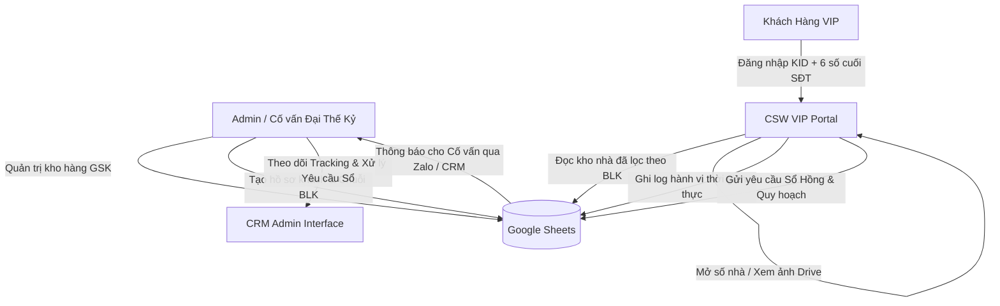
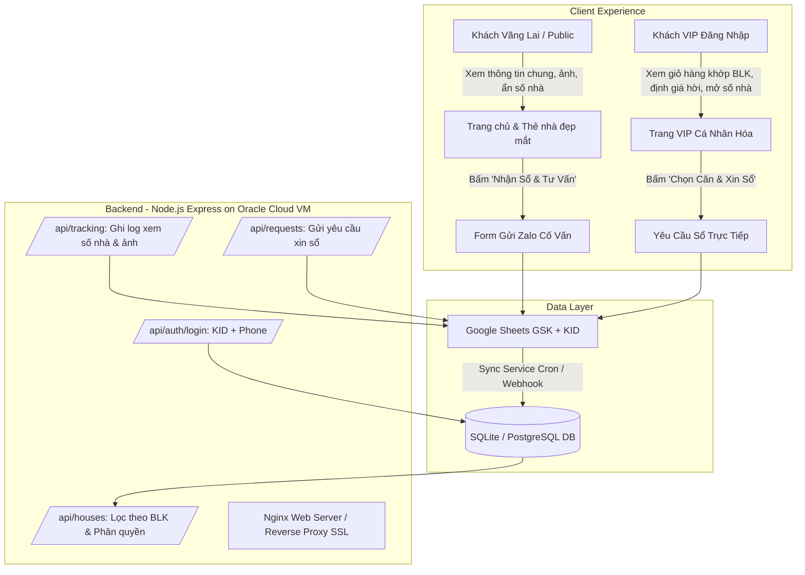

# 🏛️ CSW (CUSTOMER STREAMLIT WEB) - HỆ THỐNG CỔNG THÔNG TIN KHÁCH HÀNG VIP ĐẠI THẾ KỶ
> **TÀI LIỆU ĐẶC TẢ TOÀN DIỆN HỆ THỐNG (SYSTEM SPECIFICATION & ARCHITECTURE HANDOVER)**  
> *Dành cho AI Agent, Tech Lead và Kỹ sư phần mềm tiếp quản 100% dự án.*  
> *Phiên bản: 2.0 (Cập nhật Tháng 11/2026 - Chuẩn hóa AgGrid, Tooltip Tra cứu Đặc điểm, Phân quyền Bảo mật & Theo dõi Hành vi).*

---

## 1. 📌 BẢN CHẤT & MỤC TIÊU DỰ ÁN (CORE ESSENCE & OBJECTIVE)

### 1.1. Bản chất cốt lõi (Core Philosophy)
Hệ thống **CSW (Customer Streamlit Web / Cổng Khách VIP)** được xây dựng nhằm giải quyết bài toán mâu thuẫn lớn nhất trong ngành môi giới bất động sản nhà phố:
1. **Khách hàng muốn**: Xem giỏ hàng hàng trăm căn nhà một cách trực quan, nhanh gọn, biết được thông tin quy hoạch, kích thước, giá bán, định giá và hình ảnh thực tế.
2. **Môi giới / Doanh nghiệp cần**: 
   - **Bảo mật thông tin nội bộ**: Tuyệt đối không để lộ thông tin chủ nhà, đầu chủ, số nhà chính xác (tránh bị nhảy cò, mất khách hoặc lộ nguồn hàng cho đối thủ).
   - **Kiểm soát phân quyền**: Khách nào chỉ được xem những căn đúng nhu cầu / ngân sách của khách đó (tránh ngợp thông tin).
   - **Đo lường hành vi theo thời gian thực (Behavioral Tracking)**: Biết chính xác khách VIP đang xem căn nào, click mở địa chỉ căn nào, xem album ảnh nào và thời gian bao lâu để Cố vấn bám sát tư vấn chốt deal.
   - **Kênh tương tác trực tiếp (Lead Conversion)**: Khách chọn các căn ưng ý chỉ với 1 click và bấm **[Gửi Cố vấn xin Sổ Hồng]** để nhận tài liệu pháp lý qua Zalo.

### 1.2. Môi trường triển khai hiện tại
* **Repository**: `https://github.com/stevenphamntvn/dtk-crm` (nhánh `main`)
* **Cloud App**: `https://dtk-crm.streamlit.app` (Streamlit Cloud auto-deploy từ GitHub)
* **Local Run**: `run.bat` (chạy trên máy tính Windows, tích hợp cả CRM Admin và CSW VIP Portal)
* **Nguồn dữ liệu trung tâm**: Google Sheets (Google Drive Cloud) đồng bộ 2 chiều với API Service Account.

---

## 2. 👥 HAI TÁC NHÂN CHÍNH TRONG HỆ THỐNG (SYSTEM ACTORS)



1. **Admin / Cố vấn (Advisor)**: 
   - Sử dụng giao diện Admin CRM (`Data/crm_app.py`) để quản lý kho nhà hàng ngàn căn (`GSK`), tạo mã khách hàng (`KID`), nhập tiêu chí lọc chuẩn hóa (`BLK`).
   - Xem thống kê lượt xem số nhà, click ảnh và danh sách yêu cầu xin sổ của từng khách VIP để phản hồi ngay lập tức.
2. **Khách hàng VIP (VIP Customer)**:
   - Truy cập giao diện CSW chuyên biệt (`Data/vip_portal.py`).
   - Đăng nhập bằng mã khách (`KID`) và mật khẩu bảo mật (6 số cuối số điện thoại cá nhân).
   - Xem bảng kho nhà tương tác AgGrid siêu mượt, ẩn số nhà (`👁️ ***`), mở địa chỉ khi cần, chọn căn quan tâm (`⭐`), gửi yêu cầu xin sổ.

---

## 3. 🗄️ CẤU TRÚC DỮ LIỆU & GOOGLE SHEETS SCHEMAS

Hệ thống kết nối Google Spreadsheet trung tâm với các sheet chính sau:

### 3.1. Sheet `GSK` (Kho Hàng Bất Động Sản Nhà Phố)
Chứa hàng nghìn căn nhà với các trường dữ liệu tiêu chuẩn:
* `uid`: Mã căn nhà duy nhất trong hệ thống (VD: `3835`, `4197`).
* `sonha`: Số nhà thực tế (VD: `280.4`, `12/3A`). *Chỉ mở khi khách click.*
* `tenduong`: Tên đường (VD: `Bạch Đằng`, `Lê Quang Định`).
* `quan`: Quận (VD: `Bình Thạnh`, `Phú Nhuận`, `Q1`).
* `phuong`: Phường (VD: `14`, `24`, `03`).
* `ngang`: Chiều ngang mặt tiền nhà (m).
* `dai`: Chiều dài nhà (m).
* `dientich`: Diện tích công nhận trên sổ (m²).
* `gia`: Giá chào bán công khai (Tỷ VNĐ).
* `p/m2`: Đơn giá trên mỗi mét vuông (Triệu/m²).
* `ketcau`: Kết cấu công trình (VD: `4T`, `3L`, `Hầm 5T`, `C4`).
* `PL`: Phân loại chất lượng nhà: `TAR` (Target siêu phẩm giá rẻ), `A` (Rất tốt), `B` (Tốt), `C` (Bình thường).
* `motachitiet`: Mô tả nội bộ chứa các tag nghiệp vụ (VD: `CVI DAD 2MT TMA PN5 SCN63 SLG5 N(Bán gấp giá thương lượng)`).
* `dinhgia`: Đơn giá định giá tham chiếu khu vực (Triệu/m²). Dùng để tính giá trị thực của căn nhà.
* `URL_GGD`: Link thư mục Google Drive chứa album ảnh thật của căn nhà.
* `cus`: Nội dung giới thiệu tóm tắt dành cho khách hàng.
* *Các cột hoa hồng / đầu chủ*: `HH`, `dau_chu`, `sdt_dauchu` (Tuyệt đối không đẩy sang giao diện khách).

### 3.2. Sheet `KID` (Danh Mục Khách Hàng & Nhu Cầu)
* `KID`: Mã khách hàng duy nhất (VD: `KID_001`, `KID_053`).
* `PLK`: Phân loại khách: `VIP` (hoặc `A`, `B`).
* `ten_khach`: Tên khách hàng (hoặc trích xuất từ phần đầu `thongtin_KID`).
* `sdt`: Số điện thoại của khách hàng (6 số cuối dùng làm mật khẩu đăng nhập).
* `thongtin_KID`: Văn bản ghi chú nhu cầu khách.
* `bo_loc_KID`: Chuỗi cấu hình bộ lọc chuẩn hóa (`BLK`).

### 3.3. Sheet `VIP_Tracking` (Nhật Ký Hành Vi Khách Hàng)
Tự động ghi nhận mỗi khi khách thao tác trên giao diện:
* `timestamp`: Thời gian thao tác (ISO format `YYYY-MM-DD HH:MM:SS`).
* `kid`: Mã khách hàng (VD: `KID_053`).
* `ten_khach`: Tên khách.
* `uid`: Mã căn nhà được tác động.
* `sonha`: Số nhà thực tế được mở.
* `tenduong`: Tên đường.
* `quan_phuong`: Phường, Quận.
* `gia`: Giá căn nhà.
* `hanh_dong`: Loại hành vi:
  * `XEM_SO_NHA`: Khách click mở số nhà từ `👁️ ***`.
  * `XEM_LINK_ANH`: Khách click icon `📂` mở album ảnh Google Drive.
* `chi_tiet`: Ghi chú chi tiết hành vi.

### 3.4. Sheet `VIP_Requests` (Danh Sách Yêu Cầu Xin Sổ & Tư Vấn Sâu)
* `id`: Mã yêu cầu duy nhất (`REQ_YYYYMMDD_HHMMSS`).
* `timestamp`: Thời gian gửi yêu cầu.
* `kid`: Mã khách hàng.
* `ten_khach`: Tên khách.
* `sdt`: Số điện thoại khách.
* `so_luong`: Số lượng căn nhà khách chọn.
* `danh_sach_uid`: Danh sách các mã `uid` ngăn cách bằng dấu phẩy.
* `ghi_chu`: Lời nhắn gửi riêng cho Cố vấn.
* `trang_thai`: Trạng thái xử lý (`Mới`, `Đang xử lý`, `Đã gửi sổ`, `Đã dẫn xem`, `Hoàn tất`).

---

## 4. ⚙️ CÁC QUY TRÌNH & THUẬT TOÁN NGHIỆP VỤ CỐT LÕI

### 4.1. Quy chuẩn Chuỗi Bộ Lọc `BLK` (`bo_loc_KID` Protocol)
Chuỗi BLK là chìa khóa để hệ thống tự động lọc đúng căn cho từng khách mà không cần cấu hình thủ công:
* **Cú pháp**: `TenKhach.G{min}-{max}T.Q{ma_quan}({phuong})+Q{ma_quan}.N{ngang}M.DT{dt}.TG{tang}.PN{pn}.{TAGS}`
* **Ví dụ mẫu**: `AnhMinh.G10-25T.QBT(1,2,14)+QPN.N4M.DT50.MAT.TMA.KLP`
* **Giải mã tiêu chí**:
  * `G10-25T`: Khoảng giá từ 10 Tỷ đến 25 Tỷ.
  * `QBT(1,2,14)`: Quận Bình Thạnh (chỉ lấy Phường 1, 2, 14).
  * `+QPN`: Thêm Quận Phú Nhuận (tất cả các phường).
  * `N4M`: Bề ngang tối thiểu $\ge 4.0\text{ m}$.
  * `DT50`: Diện tích công nhận tối thiểu $\ge 50\text{ m}^2$.
  * `MAT`: Yêu cầu nhà mặt tiền.
  * `TMA`: Yêu cầu nhà có thang máy.
  * `KLP`: Không lỗi phong thủy (không đâm đường, không tóp hậu, không gần mồ mả/chùa chiền).
* **Hàm xử lý**: `parse_blk(blk_string)` tại `Data/vip_portal.py` chuyển chuỗi này thành Python dict để query DataFrame.

---

### 4.2. Từ Điển Mã Bất Động Sản Chuẩn Hóa (`code_list.txt`)
Hệ thống sử dụng bộ từ điển 28+ mã ký hiệu bất động sản độc quyền của Đại Thế Kỷ:

| Mã Tag | Tên đầy đủ / Ý nghĩa | Nhóm phân loại |
| :--- | :--- | :--- |
| **`CVI`** | Mặt tiền công viên VIP (sát / view công viên) | Vị trí cao cấp |
| **`GCV`** | Gần công viên | Vị trí thuận lợi |
| **`DAD`** | Nhà bị đâm đường | Cảnh báo phong thủy |
| **`2MT`** | Nhà 2 mặt tiền | Vị trí thoáng sáng |
| **`CGO`** | Lô góc 2 mặt tiền VIP | Vị trí kim cương |
| **`P1C`** / **`T1C`** | Phía tay phải / tay trái đường 1 chiều | Giao thông thương mại |
| **`MAT`** / **`MT`** | Nhà mặt tiền đường | Vị trí kinh doanh |
| **`HXT`** | Hẻm xe tải tránh nhau | Độ rộng hẻm |
| **`HXH`** | Hẻm xe hơi tới cửa | Độ rộng hẻm |
| **`HBG`** | Hẻm ba gác | Độ rộng hẻm |
| **`MTR`** | Gần nhà ga Metro tương lai | Tiềm năng tăng giá |
| **`SA4`** | Sổ vuông vức như tờ A4 (cực đẹp) | Hình dáng thửa đất |
| **`NOH`** | Nở hậu (tài lộc phong thủy) | Hình dáng thửa đất |
| **`TOH`** | Tóp hậu | Cảnh báo phong thủy |
| **`KLP`** | Không lỗi phong thủy | Tiêu chuẩn chọn lọc |
| **`TMA`** | Nhà có thang máy | Tiện ích công trình |
| **`NTC`** | Nội thất cao cấp / mới đẹp ở ngay | Hiện trạng hoàn thiện |
| **`VLA`** | Biệt thự (Villa) | Loại hình BĐS |
| **`VPH`** | Tòa nhà văn phòng | Loại hình BĐS |
| **`KSA`** | Khách sạn | Loại hình BĐS |
| **`C4`** | Nhà cấp 4 (tiện xây mới) | Hiện trạng kết cấu |
| **`CHV{x}`** | Căn hộ dịch vụ {x} phòng ngủ | Công năng khai thác dòng tiền |
| **`PN{x}`** | {x} Phòng ngủ | Công năng sinh hoạt |
| **`DTN{x}`** | Đường trước nhà rộng {x} mét | Hạ tầng trước cửa |
| **`QH{x}`** | Quy hoạch lộ giới đường {x} mét | Pháp lý quy hoạch |
| **`SCN{x}`** | Sổ công nhận {x} $\text{m}^2$ | Diện tích pháp lý |
| **`SLG{x}`** | Sau lộ giới còn lại {x} $\text{m}^2$ | Diện tích thực tế sử dụng |

* **Trích xuất tag**: Hàm `extract_highlight(text)` tự động quét toàn bộ `motachitiet` và nhận diện cả tag cố định lẫn tag động bằng regex `(PN|SCN|SLG|QH|DTN|CHV)\s*([0-9.,]+)`.
* **Diễn giải tự động**: Hàm `explain_tags(tag_str)` biên dịch các tag thành chuỗi văn bản thuần Việt để đưa vào tooltip.

---

### 4.3. Thuật Toán Định Giá Tham Khảo Đại Thế Kỷ
Hệ thống tính toán giá trị thực tham chiếu cho mỗi căn nhà dựa trên diện tích sổ, diện tích sau lộ giới và đơn giá quận/phường (`dinhgia`):
```python
def apply_dinh_gia(df, c_mota, c_dt, c_q):
    # Trích xuất SLG (sau lộ giới) và SCN (sổ công nhận)
    slg_final = slg_val if slg_val > 0 else scn_final
    scn_final = max(scn_final, slg_final)
    sm_final = max(sm_num, scn_final)
    # Diện tích tính định giá = SLG + 50% phần dính lộ giới + 25% phần diện tích dôi dư
    sdg_val = slg_final + (scn_final - slg_final) * 0.5 + (sm_final - scn_final) * 0.25
    # Giá trị định giá (Tỷ) = (sdg_val * don_gia_m2) / 1000
    return round((sdg_val * dongia) / 1000, 1)
```
* **Chỉ báo giá hời**: Khi `Giá bán < Đ.Giá`, ô giá bán trên bảng sẽ tự động đổi màu **Xanh lá cây (`#10B981`)** đậm nét để thu hút sự chú ý của khách hàng.

---

### 4.4. Cơ Chế Xác Thực & Đăng Nhập Khách VIP
* **Tên đăng nhập**: Chuẩn hóa mọi biến thể `k53`, `K053`, `KID53`, `KID_053` $\rightarrow$ `KID_053`.
* **Mật khẩu**: 6 số cuối của số điện thoại được đăng ký trong hệ thống (lấy từ cột `sdt` hoặc quét regex trong `thongtin_KID`).
* **Tài khoản Demo Fallback**: Tài khoản `K053` có thể đăng nhập bằng các mật khẩu demo (`345678`, `123456`, `dtk2025`, `666888`) ngay cả khi cache chưa tải xong hoặc mạng chập chờn.

---

### 4.5. Cơ Chế Ẩn / Mở Số Nhà & Bắt Sự Kiện (Event-driven AgGrid)
* Mặc định ở cột **Số nhà**, giá trị hiển thị là: `👁️ ***` với đường viền gạch chân màu xanh dương.
* Khi khách click vào ô `👁️ ***`:
  1. JavaScript nội tuyến (`JsCode`) bắt sự kiện `onCellClicked`, ngay lập tức gán số nhà thật vào ô hiển thị và gán `_uid` vào cột ẩn `_reveal_trigger`.
  2. Streamlit nhận diện `_reveal_trigger`, lưu `_uid` vào `st.session_state['vip_revealed_uids']`.
  3. Ghi một dòng log hành vi vào Google Sheet `VIP_Tracking` (và file CSV cache) với hành động `XEM_SO_NHA`.
  4. Bật thông báo Toast: `📍 Đã mở địa chỉ: {số nhà} {tên đường}!`.

---

## 5. 🖥️ CẤU HÌNH BẢNG TƯƠNG TÁC AGGRID DÀNH CHO KHÁCH VIP

Bảng AgGrid của Khách VIP được thiết kế siêu gọn, tối ưu để hiển thị 100-300 căn mượt mà với thanh cuộn ảo (virtual scrolling) và 100% cột có tooltip giải nghĩa:

```text
[⭐] [PL] [Số nhà] [Ảnh] [Đường] [P.] [Q.] [Ngang] [Dài] [DT] [Giá] [Đ.Giá] [Tr/m²] [K.Cấu] [Đ.Điểm] [G.Chú]
```

### Chi tiết các cột hiển thị:
1. **`⭐`** (Pinned Left, width 65px): Icon `⭐ Chọn` hoặc `✅ Đã chọn`. Click vào để thêm/bỏ khỏi danh sách quan tâm xin sổ.
2. **`PL`** (width 50px): Phân loại nhà (`TAR`, `A`, `B`). Xếp ưu tiên từ cao xuống thấp.
3. **`Số nhà`** (width 95px): Hiển thị `👁️ ***` (click để xem thật).
4. **`Ảnh`** (width 45px): Icon `📂` nếu có link Google Drive, click mở tab mới xem ảnh.
5. **`Đường`** (width 130px): Tên đường (chữ màu xanh cyan nổi bật).
6. **`P.`** (width 55px): Tên Phường (được rút gọn số phường).
7. **`Q.`** (width 65px): Tên Quận (viết hoa chữ cái đầu).
8. **`Ngang`** (width 55px): Chiều ngang mặt tiền (m).
9. **`Dài`** (width 55px): Chiều dài thửa đất (m).
10. **`DT`** (width 55px): Diện tích công nhận trên sổ ($\text{m}^2$).
11. **`Giá`** (width 65px): Giá chào bán (Tỷ VNĐ) — *Tô xanh lá `#10B981` nếu Giá < Đ.Giá*.
12. **`Đ.Giá`** (width 65px): Giá tham khảo theo thuật toán định giá Đại Thế Kỷ (Tỷ VNĐ).
13. **`Tr/m²`** (width 65px): Đơn giá Triệu/$\text{m}^2$.
14. **`K.Cấu`** (width 60px): Kết cấu số tầng (VD: `4T`, `Hầm 6T`).
15. **`Đ.Điểm`** (width 200px): Các mã đặc điểm trích xuất (`CVI, TMA, 2MT...`). Có cell tooltip tự động hiển thị nghĩa khi rê chuột.
16. **`G.Chú`** (width 400px): Ghi chú tóm tắt riêng trích xuất từ `N(...)`.

### Cột ẩn kỹ thuật (Hidden columns):
`_uid`, `_real_sonha`, `_link_ggd`, `_reveal_trigger`, `_link_trigger`, `_dacdiem_tooltip`.

---

## 6. 📂 CẤU TRÚC MÃ NGUỒN HIỆN TẠI

```text
DTK_CRM/
├── Data/
│   ├── crm_app.py               # Hệ thống CRM Quản trị & Điều hướng chính (~3,700 dòng)
│   ├── vip_portal.py            # ⭐ Module Cổng Thông Tin Khách VIP CSW (~1,150 dòng)
│   ├── credentials.json         # Google Service Account JSON (chạy Local)
│   └── cache/                   # Thư mục lưu đệm dữ liệu Offline (CSV & JSON)
│       ├── gsk_cache.csv
│       ├── mykid_cache.csv
│       ├── vip_tracking.csv
│       └── vip_requests.csv
├── tests/
│   ├── test_vip_portal.py       # Bộ kiểm thử tự động toàn diện cho VIP Portal (30 test cases)
│   ├── test_customer_creation.py
│   └── test_sync_report.py
├── .streamlit/
│   ├── config.toml              # Cấu hình giao diện Streamlit headless
│   └── secrets.toml             # Chứa GOOGLE_CREDENTIALS trên Streamlit Cloud
├── requirements.txt             # streamlit, st-aggrid, pandas, gspread, oauth2client...
└── run.bat                      # Script 1-click khởi chạy trên Windows
```

---

## 7. 🚀 KẾ HOẠCH BÀN GIAO & PHÁT TRIỂN WEB MỚI TRÊN ORACLE CLOUD (DỰ ÁN TIẾP THEO)

### 7.1. Bối cảnh & Yêu cầu từ Chủ Dự Án
> *"Chúng ta làm 1 web khác với chức năng tương tự nhưng giao diện kiểu như trang ở đây `D:\DSH_WP\Web_BDS`. Bản chất là cho khách xem nhà và chúng ta kiểm soát khách nào xem được gì, liên hệ với chúng ta như thế nào. Tôi đã đăng ký máy ảo ở Oracle."*

### 7.2. Phân tích nền tảng mẫu `D:\DSH_WP\Web_BDS`
Tại `D:\DSH_WP\Web_BDS`, dự án đã có sẵn khung sườn Web thương mại chuyên nghiệp:
* **Backend**: Node.js + Express (`server.js`, `db.js`, `sync_service.js`, `google_sync.js`, `auth.js`, `images.js`).
* **Database**: SQLite (`db.js`) lưu trữ dữ liệu nhà được đồng bộ định kỳ từ Google Sheets.
* **Frontend**: HTML5 / CSS3 / Vanilla JS chuẩn SEO, giao diện thẻ nhà (cards) như *Batdongsan*, *Nhà Phố Sài Thành*, *dinhgiaNha.vn*:
  * `public/index.html`: Trang chủ tìm kiếm, lọc theo quận, khoảng giá, diện tích, kết cấu.
  * `public/house.html`: Trang chi tiết từng căn nhà (thư viện ảnh trượt, vị trí bản đồ, thông số, nút liên hệ Cố vấn).
  * `public/login.html`: Trang đăng nhập thành viên / khách VIP.
  * `public/admin.html`: Trang quản trị dành cho nội bộ.
  * `public/tu-van-tim-nha.html` & `public/ky-gui.html`: Form thu thập nhu cầu (Lead Generation).

### 7.3. Kiến trúc Cổng Khách Hàng Web Mới (Target Architecture)



### 7.4. Các Nguyên Tắc Bất Di Bất Dịch Cần Đảm Bảo Khi Xây Dựng Web Mới
1. **Kiểm soát thông tin hiển thị (Information Visibility Control)**:
   - **Khách thường (Public/Guest)**: Chỉ thấy Quận, Phường, Tên đường (ở mức chung), diện tích, số tầng, giá rao, hình ảnh công khai. **Tuyệt đối ẩn số nhà.**
   - **Khách VIP (Đã đăng nhập qua KID + SĐT)**: Thấy các căn đã được lọc cá nhân hóa theo chuỗi `BLK`, thấy định giá tham khảo, độ chênh lệch giá, và được cấp quyền click mở số nhà chính xác (có ghi log tracking).
   - **Nội bộ môi giới**: Thấy toàn bộ `motachitiet`, thông tin đầu chủ, hoa hồng, ghi chú cá nhân.
2. **Kênh liên hệ trực tiếp & Chống lộ nguồn hàng (Lead Routing)**:
   - Mọi nút bấm "Tư vấn căn này", "Gửi sổ qua Zalo", "Báo giá nhanh" đều được định tuyến về Cố vấn phụ trách của khách (hoặc hotline/Zalo của công ty), kèm theo mã `uid` và link căn nhà.
3. **Triển khai trên Máy ảo Oracle Cloud (Oracle Cloud Free Tier VM)**:
   - HĐH: Ubuntu 22.04 LTS / Debian.
   - Web Server: Nginx (Reverse proxy port 80/443 sang Node.js port 3000, cấu hình SSL tự động bằng Let's Encrypt / Certbot).
   - Process Manager: `pm2` chạy nền dịch vụ Express và tiến trình đồng bộ dữ liệu `sync_service.js`.
   - Firewall / Security Lists: Mở cổng Ingress 80, 443 trên Oracle Cloud VCN và `ufw` trên VM.

---

## 8. 🎯 HƯỚNG DẪN DÀNH CHO AI AGENT TIẾP QUẢN
Khi nhận nhiệm vụ tiếp theo, AI Agent hãy làm theo các bước:
1. Đọc kỹ tài liệu này (`CSW_SYSTEM_SPECIFICATION.md`) và tài liệu gốc trong `D:\DSH_WP\Web_BDS\Web_BDS_Readme\`.
2. Giữ nguyên logic xác thực `KID` + 6 số cuối SĐT và bộ từ điển `code_list.txt`.
3. Khi code backend cho Web mới, kế thừa cấu trúc Express + SQLite có sẵn tại `D:\DSH_WP\Web_BDS\server.js` và `db.js`.
4. Viết các API endpoint `/api/vip/houses`, `/api/vip/reveal-address`, `/api/vip/submit-request` chuẩn RESTful để kết nối với giao diện web đẹp mắt của `Web_BDS`.
5. Tạo script thiết lập và deploy tự động (Bash script) để người dùng chỉ cần chạy 1 dòng lệnh trên máy ảo Oracle là website hoạt động ngay.
